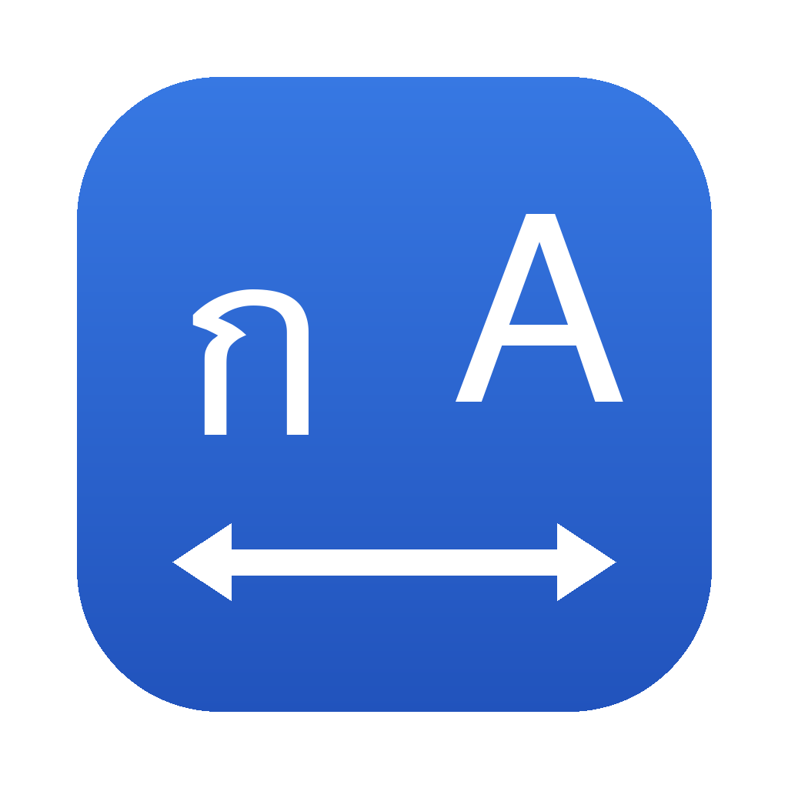

  

<h1 align="center">KeySwap</h1>

  <b>พิมพ์ผิดแป้นไทย↔อังกฤษ แก้ให้เอง</b> 
  พิมพ์ <code>l;ylfu</code> ได้ <b>สวัสดี</b> · พิมพ์ <code>ไนพสก</code> ได้ <b>world</b>

  

  ทำงานในทุกแอป · อยู่บนแถบเมนู ·
  macOS 11 ขึ้นไป · Apple silicon · อัปเดตอัตโนมัติ ·
  <a href="https://github.com/AImunich20/keyswap-releases/releases">ทุกเวอร์ชัน</a>

## ติดตั้ง
1. ดาวน์โหลด `KeySwap.dmg` แล้วลาก **KeySwap** ไปไว้ใน **Applications**
2. เปิดครั้งแรก: คลิกขวาที่แอป → **Open** (แอปยังไม่ได้ลงทะเบียนกับ Apple)
3. กด **Open Accessibility settings** ในหน้าต่าง KeySwap แล้วเปิดสวิตช์ KeySwap ใน Privacy & Security › Accessibility
4. ต้องมีแป้นพิมพ์ **Thai** (เกษมณี) ใน System Settings › Keyboard › Input Sources

KeySwap อยู่บนแถบเมนูเป็นไอคอน ⇄ สีเดียว ปิดหน้าต่างแล้วยังทำงานต่อ

| ไอคอน | โหมด |
|---|---|
| เข้มทั้งหมด | Automatic: แก้ให้เองระหว่างพิมพ์ |
| ลูกศรจาง | Manual: แก้เมื่อกด ⇧⌫ |
| จางทั้งหมด | Off |

| ปุ่มลัด | ทำอะไร |
|---|---|
| ⇧ ⌫ | สลับภาษาของคำที่เพิ่งพิมพ์ หรือยกเลิกการแก้ล่าสุด |
| ⌃ ⌥ \ | สลับ Automatic ↔ Manual |
| ⌥ ⇧ ⌫ | แปลงข้อความที่เลือกเป็นอีกแป้น (ก ↔ a) กดซ้ำเพื่อแปลงกลับ |

ปุ่มลัดทั้งหมดเปลี่ยนได้ในแท็บ General

## ใหม่ใน 2.0
- **คำพิเศษ**: ตั้งคำที่ห้ามเปลี่ยน (ชื่อ, ศัพท์เฉพาะ) และคำที่ให้เปลี่ยนเสมอ ในแท็บ Words
- **แทนที่ข้อความ**: พิมพ์ shortcut แล้วเว้นวรรค ได้วลีเต็ม เหมือน Text Replacements ของ Apple แต่ใช้ได้ทุกแอป และนำเข้ารายการเดิมจาก macOS ได้
- **ตั้งปุ่มลัดเองได้**: กดที่ปุ่มลัดในแท็บ General แล้วกดคีย์ที่ต้องการ

## อัปเดต
แอปเช็กเวอร์ชันใหม่ทุกครั้งที่เปิด ถ้ามีจะขึ้นปุ่ม **Update and restart** หรือกด **Check for updates** ในแท็บ About

## ความเป็นส่วนตัว
KeySwap ดูปุ่มที่กดเพื่อตรวจคำที่กำลังพิมพ์เท่านั้น ไม่บันทึกและไม่ส่งข้อความที่พิมพ์ไปไหน การเชื่อมต่ออินเทอร์เน็ตมีแค่ตอนเช็กอัปเดตจาก GitHub ไม่ทำงานในช่องรหัสผ่าน

---

## English
KeySwap fixes words typed on the wrong keyboard (Thai Kedmanee ↔ English QWERTY) in every app on your Mac. Download `KeySwap.dmg`, drag it to Applications, right-click → Open the first time, then allow it in Privacy & Security › Accessibility. It lives in the menu bar and updates itself from this repo's releases.
